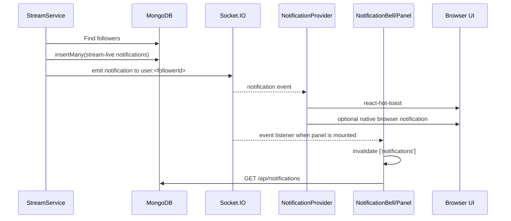
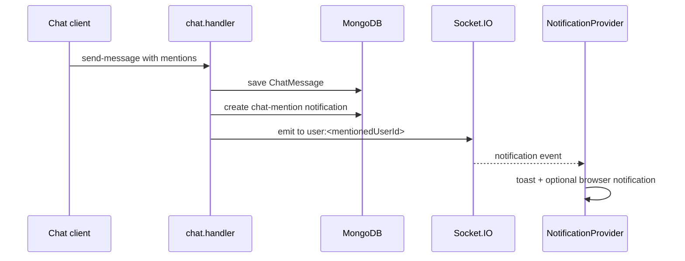

# StreamHub Notification Service Architecture

## 1. Executive summary

StreamHub uses a hybrid notification design:

1. **MongoDB is the durable notification store.** Each notification is stored for a target user with a read/unread state.
2. **Socket.IO is the real-time delivery channel.** An authenticated browser connection joins a private room named `user:<userId>`. Backend producers emit a `notification` event to that room.
3. **REST APIs are used for notification history and read state.** The frontend loads notifications with `GET /api/notifications` and updates read state with `PATCH` requests.
4. **The browser presents notifications in three ways:** an in-app toast, an optional native browser notification, and the notification bell/panel.

The intended durable-plus-live flow is:

```text
Domain event
   │
   ├── create Notification document in MongoDB
   └── emit Socket.IO `notification` event to user:<targetUserId>
                    │
                    ▼
         NotificationProvider receives event
                    │
          ┌─────────┴─────────┐
          ▼                   ▼
   react-hot-toast       Browser Notification API

NotificationBell / Panel ──REST──> load stored notifications
NotificationPanel ─────────REST──> mark one/all as read
```

This document describes the implementation currently present in the repository, including known inconsistencies and operational limitations.

## 2. Main components

| Layer | Component | Responsibility |
|---|---|---|
| Frontend bootstrap | [`frontend/app/layout.tsx`](../frontend/app/layout.tsx) | Mounts `AuthProvider`, `NotificationProvider`, React Query, and the global toast renderer. |
| Frontend real-time | [`frontend/lib/NotificationContext.tsx`](../frontend/lib/NotificationContext.tsx) | Opens the user Socket.IO connection, receives `notification`, displays toast/browser notifications, and exposes the socket through React context. |
| Frontend history | [`frontend/components/NotificationBell.tsx`](../frontend/components/NotificationBell.tsx) | Fetches the latest notifications and calculates the bell badge. |
| Frontend interaction | [`frontend/components/NotificationPanel.tsx`](../frontend/components/NotificationPanel.tsx) | Lists notifications, subscribes for cache invalidation while open, marks notifications read, and navigates to live streams. |
| Frontend auth/API | [`frontend/lib/AuthContext.tsx`](../frontend/lib/AuthContext.tsx) | Stores JWTs in `sessionStorage`, injects the access token into Axios requests, and supplies the Socket.IO auth token. |
| HTTP API | [`backend/src/routes/notification.routes.ts`](../backend/src/routes/notification.routes.ts) | Exposes read/list endpoints behind authentication. |
| HTTP controller | [`backend/src/controllers/notification.controller.ts`](../backend/src/controllers/notification.controller.ts) | Reads and updates notification documents for the authenticated user. |
| Persistence | [`backend/src/models/Notification.ts`](../backend/src/models/Notification.ts) | Defines the MongoDB/Mongoose notification document, indexes, and 30-day TTL. |
| Socket bootstrap | [`backend/src/socket/socket.server.ts`](../backend/src/socket/socket.server.ts) | Authenticates Socket.IO connections, joins user notification rooms, and registers socket handlers. |
| Socket auth | [`backend/src/middleware/auth.middleware.ts`](../backend/src/middleware/auth.middleware.ts) | Verifies the JWT supplied in `socket.handshake.auth.token`. |
| Event producer: stream live | [`backend/src/services/StreamService.ts`](../backend/src/services/StreamService.ts) | Notifies followers when the stream becomes live. |
| Event producer: mention | [`backend/src/socket/handlers/chat.handler.ts`](../backend/src/socket/handlers/chat.handler.ts) | Creates and emits notifications for users mentioned in chat. |
| Event producer: new follower | [`backend/src/controllers/follow.controller.ts`](../backend/src/controllers/follow.controller.ts) | Creates a notification when a user follows another user and attempts to emit it live. |

## 3. Runtime initialization and authentication

### Backend startup

`backend/server.ts` performs the following startup sequence:

1. Creates the Express application.
2. Creates the HTTP/HTTPS server and attaches Socket.IO.
3. Stores the Socket.IO instance on the Express app as `app.set("io", io)`.
4. Initializes MongoDB and application services.
5. Assigns the Socket.IO instance to `StreamService` (`streamService.io = io`).
6. Registers REST routes.
7. Registers Socket.IO authentication and event handlers.

Socket.IO is configured with CORS credentials, polling/websocket transports, and upgrade support in [`backend/src/config/server.config.ts`](../backend/src/config/server.config.ts).

### Frontend authentication

`AuthContext` stores `accessToken` and `refreshToken` in `sessionStorage` after login/register. The Axios request interceptor adds:

```http
Authorization: Bearer <accessToken>
```

The same access token is passed to Socket.IO as:

```ts
io(API_URL, { auth: { token } })
```

The notification socket is created only after `AuthContext` has a user. When the user changes or logs out, the provider closes the old connection through the effect cleanup.

### Socket authentication and private room

`AuthMiddleware.socketAuth` verifies the handshake token, loads the user from MongoDB, and sets `socket.userId`/`socket.data.userId`. The middleware currently allows a socket with no token to connect as an unauthenticated socket; such a socket does not receive a private user room.

For an authenticated connection, [`backend/src/socket/socket.server.ts`](../backend/src/socket/socket.server.ts) joins:

```text
user:<userId>
```

All notification producers must use that exact room name to deliver to the intended user.

## 4. Notification data model

The Mongoose model is [`backend/src/models/Notification.ts`](../backend/src/models/Notification.ts).

### Stored fields

| Field | Type | Meaning |
|---|---|---|
| `userId` | `ObjectId` | Recipient; references `User`. |
| `type` | enum | `stream-live`, `chat-mention`, or `new-follower`. |
| `title` | string | Short display heading. |
| `message` | string | Main display text. |
| `read` | boolean | Defaults to `false`; changed by read endpoints. |
| `data.streamId` | string | Stream identifier for live-stream and mention context. |
| `data.streamTitle` | string | Stream title. |
| `data.followerId` | `ObjectId` | Follower identifier for a new-follower notification. |
| `data.followerUsername` | string | Follower display name. |
| `data.followerAvatar` | string | Follower avatar URL. |
| `createdAt` / `updatedAt` | date | Added by Mongoose timestamps. |

### Indexes and retention

- `{ userId: 1, read: 1, createdAt: -1 }` supports per-user unread/latest queries.
- `createdAt` has a TTL index of `2,592,000` seconds, so stored notifications expire after approximately 30 days.
- `userId`, `type`, and `read` also have individual indexes.

The current model does not explicitly declare all fields that producers place into `data`, such as `streamerId`, `streamerUsername`, `streamerAvatar`, and `streamCategory`. Because Mongoose strict schemas generally discard undeclared nested fields, the real-time event can contain more data than the persisted document returned later by the history API. This should be treated as a schema/contract mismatch to resolve.

## 5. Supported notification types and producers

### A. Stream goes live

Source: [`backend/src/services/StreamService.ts`](../backend/src/services/StreamService.ts).

The notification is generated inside `produce()` after the stream is updated to `isLive: true`. It runs only when:

- the produced media kind is `video`;
- the producer is not a screen share; and
- the streamer has followers.

The service:

1. Finds all `Follow` documents where `followingId` is the streamer.
2. Builds one notification per follower.
3. Persists all notifications with `Notification.insertMany()`.
4. Emits a `notification` event to each follower's `user:<followerId>` room.

The persisted event uses a title such as `<streamer> is live`, the stream title as the message, and stream metadata in `data`. The emitted event is assembled separately and does not include the MongoDB `_id`, `read`, or timestamps.

### B. Chat mention

Source: [`backend/src/socket/handlers/chat.handler.ts`](../backend/src/socket/handlers/chat.handler.ts).

When `chatService.sendMessage()` returns a message with a non-empty `mentions` array, the handler loops over mentioned user IDs. For each mentioned user it:

1. Creates a `chat-mention` document.
2. Sets `data.streamId` to the chat room/stream ID.
3. Emits the created document to `user:<mentionedUserId>`.
4. Separately broadcasts the chat message to `room:<streamId>`.

This path uses the same room format as socket connection setup.

### C. New follower

Source: [`backend/src/controllers/follow.controller.ts`](../backend/src/controllers/follow.controller.ts).

After creating the `Follow` document and incrementing both users' follower/following counters, the controller:

1. Loads the follower's username and avatar.
2. Creates a `new-follower` notification for the followed user.
3. Attempts to emit the notification through `req.app.get("io")`.

There is currently a delivery defect here: the controller emits to `user-${userId}`, while socket setup joins `user:${userId}`. The notification is saved and will be visible through REST, but the live Socket.IO event will not reach the intended recipient unless the room naming is made consistent.

## 6. Frontend behavior

### Global provider and live delivery

`NotificationProvider` is mounted globally inside the root layout, so it is available on pages that use the shared `Navbar`.

After the user is available, it creates a Socket.IO client and listens for `notification`. For each event it:

- logs the event;
- renders a five-second custom `react-hot-toast` toast in the top-right;
- selects an avatar/emoji based on notification type;
- optionally renders stream category metadata;
- invokes the native `Notification` API if browser permission is `granted`.

The provider requests browser notification permission on mount when the permission state is `default`. Native browser notifications are therefore an enhancement only; MongoDB and Socket.IO remain the application notification system.

### Bell and history loading

`NotificationBell` calls:

```http
GET /api/notifications?limit=10
```

It reads `res.data.notifications`, then calculates the badge as the number of unread records in that returned array. The API also returns `unreadCount`, but the frontend currently ignores it. Therefore the badge is an unread count among the latest 10 records, not necessarily the total unread count.

The bell is rendered by [`frontend/components/ui/Navbar.tsx`](../frontend/components/ui/Navbar.tsx), which is used across the authenticated application pages.

### Panel and read state

When opened, `NotificationPanel` loads the same query and registers another `notification` listener. That listener invalidates the React Query cache, causing the list to refresh after a new event.

User actions map to these calls:

```http
PATCH /api/notifications/<notificationId>/read
PATCH /api/notifications/read-all
```

The panel also optimistically updates its React Query cache after the request succeeds.

For `stream-live` notifications, clicking the item first requests the stream record, verifies `data.stream.isLive`, marks the notification read, and routes the user to `/watch/<streamId>`. If the stream has ended or cannot be loaded, it shows an alert and leaves the notification state unchanged.

## 7. REST API contract

All notification routes are mounted under `/api/notifications` and are protected by `AuthMiddleware.authenticate` at the application mount and again in the router.

| Method | Endpoint | Behavior |
|---|---|---|
| `GET` | `/api/notifications?limit=20&unreadOnly=false` | Returns the authenticated user's newest notifications and a total `unreadCount`. |
| `PATCH` | `/api/notifications/:id/read` | Marks one notification read, scoped by both notification ID and authenticated user ID. |
| `PATCH` | `/api/notifications/read-all` | Marks all unread notifications for the authenticated user read and returns `modifiedCount`. |

The list controller sorts by `createdAt` descending, applies the requested limit, sends no-cache headers, and scopes every query by `req.user.id`. This prevents a user from reading or mutating another user's notifications through these endpoints.

## 8. End-to-end event sequences

### Stream-live sequence



### Chat-mention sequence



### New-follower sequence as implemented

```mermaid
sequenceDiagram
    participant F as Follower client
    participant FC as follow.controller
    participant DB as MongoDB
    participant IO as Socket.IO
    participant R as Recipient socket

    F->>FC: POST /api/users/:userId/follow
    FC->>DB: create Follow and Notification
    FC->>IO: emit to user-<userId>
    Note over IO,R: Socket joined user:<userId>
    IO--xR: room mismatch; live delivery fails
    R->>FC: GET /api/notifications later
    FC->>DB: read persisted notification
```

## 9. Delivery and consistency characteristics

### What is durable

- Stream-live, chat-mention, and new-follower records are written to MongoDB before/around live delivery.
- A disconnected user can retrieve persisted notifications later through REST, subject to the 30-day TTL.
- Read state is stored server-side and scoped to the recipient.

### What is real-time only

- Toasts and native browser notifications exist only while the browser has a live Socket.IO connection.
- Socket events are not queued for a disconnected browser. Recovery depends on the subsequent REST fetch.
- The live event payload is not guaranteed to be identical to the persisted document because producers build some event payloads separately.

### Current consistency gaps

1. **New-follower room mismatch:** `user-${id}` is emitted, but `user:${id}` is joined.
2. **Persisted/live data mismatch:** stream-live producers use fields not declared in the notification schema (`streamer*`, `streamCategory`, and `streamerId`).
3. **Unread badge scope:** the API returns a total unread count, but `NotificationBell` counts only the latest 10 fetched records.
4. **Closed-panel cache freshness:** `NotificationProvider` shows the toast but does not invalidate the global `['notifications']` query. The panel registers an invalidation listener only when it is open, so the closed bell can remain stale until another refetch occurs.
5. **Notification preference is not enforced:** `User.preferences.notifications` exists in the user model, but notification producers do not check it.
6. **Duplicate Socket.IO connections:** the global notification socket coexists with page-specific sockets in dashboard/browse/watch/stream pages. This is functional but adds connections and repeated backend handler registration per browser page.
7. **No pagination cursor/offset:** the list API supports a limit but not a cursor or skip value, so the UI only has the newest page of notifications.

## 10. Recommended target contract

To make the service easier to evolve, all producers should publish the same logical shape, and the frontend should use one shared TypeScript type:

```ts
type NotificationType = "stream-live" | "chat-mention" | "new-follower";

interface NotificationPayload {
  _id?: string;
  userId: string;
  type: NotificationType;
  title: string;
  message: string;
  read: boolean;
  data: {
    streamId?: string;
    streamTitle?: string;
    streamCategory?: string;
    streamerId?: string;
    streamerUsername?: string;
    streamerAvatar?: string;
    followerId?: string;
    followerUsername?: string;
    followerAvatar?: string;
  };
  createdAt?: string;
  updatedAt?: string;
}
```

The recommended implementation direction is:

- define every `data` field in the Mongoose schema;
- use one room helper, for example `getUserNotificationRoom(userId)`, everywhere;
- emit the created MongoDB document, or normalize it into the same DTO for every producer;
- invalidate the notification query from the global Socket.IO listener, not only from the open panel;
- use the server-returned `unreadCount` for the bell badge;
- add preference filtering and pagination if those are product requirements;
- consolidate page-specific notification listeners onto the global notification connection.

## 11. Verification checklist

To verify the current service manually:

1. Log in as User A and User B in separate browser sessions.
2. Confirm the browser console shows a notification socket connection for each authenticated user.
3. Have User A follow User B. Confirm the notification appears in MongoDB and through `GET /api/notifications`; live delivery currently exposes the room-name defect.
4. Have User B start a stream and produce the first video track. Confirm a `stream-live` document is inserted for each follower and a Socket.IO event is received.
5. Send a chat message mentioning another user. Confirm the `chat-mention` document and event.
6. Open the bell, mark one notification read, then mark all read. Confirm the corresponding MongoDB `read` values change.
7. Inspect the persisted stream-live `data` object and compare it with the live event payload to detect schema-stripped fields.
